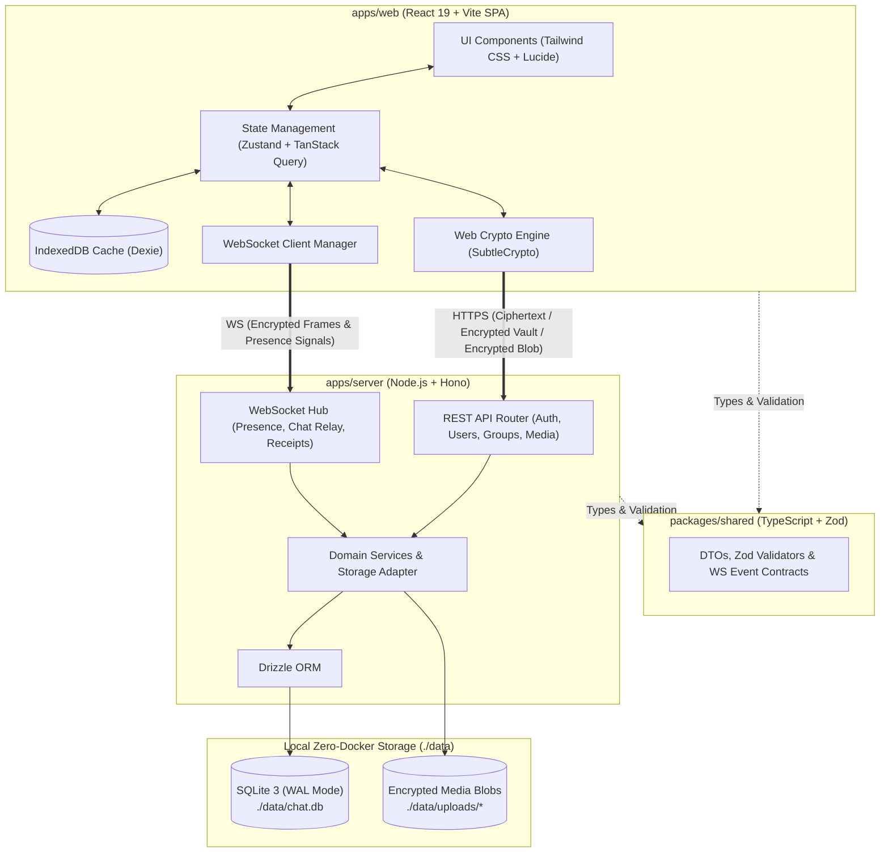
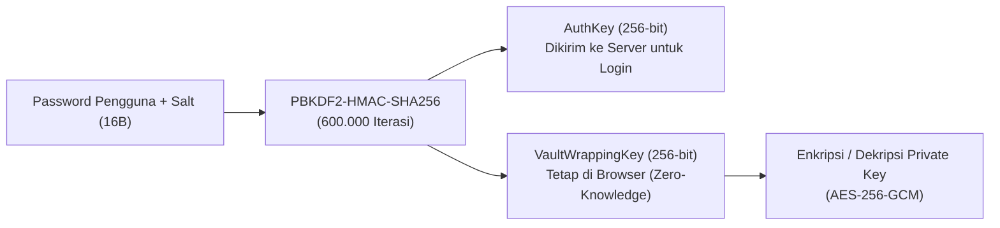
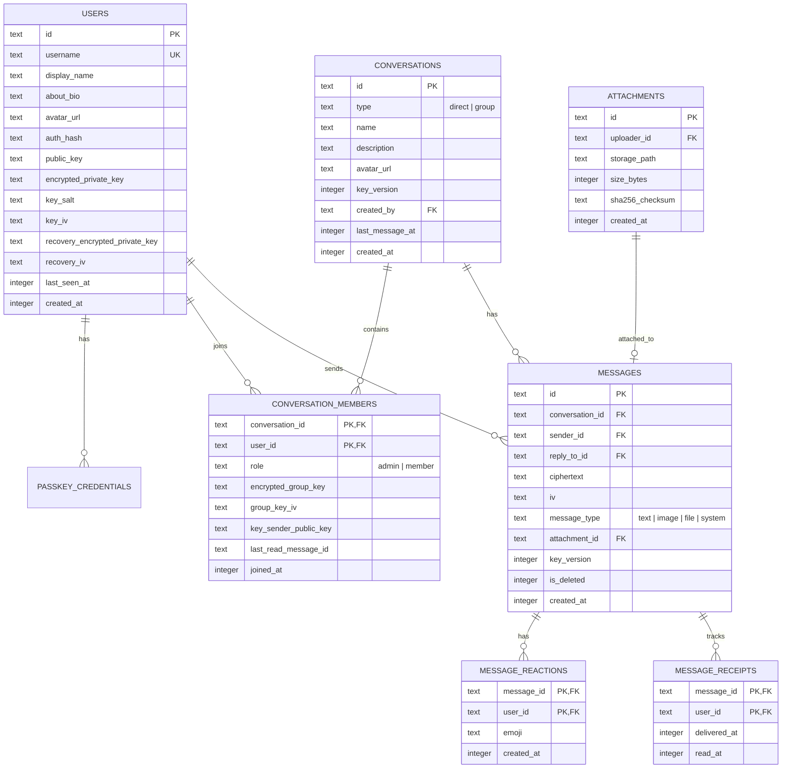

# System & Cryptography Architecture (`ARCHITECTURE.md`)
**Nama Proyek:** WhisperWeb — Private E2EE Web Messenger  
**Arsitektur Utama:** Fullstack TypeScript Monorepo + Client-Side Web Crypto E2EE + Zero-Docker Local Persistence (SQLite WAL & Local Disk Blob Storage)

---

## 1. Gambaran Umum Arsitektur (System Overview)

Aplikasi dirancang menggunakan pendekatan **Zero-Knowledge Server Architecture**. Seluruh logika kriptografi (pembangkitan kunci, pertukaran kunci ECDH, enkripsi pesan teks, hingga enkripsi biner gambar/dokumen) dilakukan **100% di sisi klien (Browser)** menggunakan `Web Crypto API`. Server bertindak murni sebagai *authenticated relay*, penyimpan *ciphertext*, dan penyimpan *encrypted key vault*.



---

## 2. Tech Stack & Struktur Monorepo

### 2.1 Daftar Teknologi Utama
- **Workspace Manager:** `npm workspaces` (atau `pnpm`) dengan TypeScript `strict: true`.
- **Frontend (`apps/web`):**
  - **Framework:** React 19 + Vite + TypeScript.
  - **Styling:** Tailwind CSS v4 + `lucide-react` (ikon) + `clsx` / `tailwind-merge`.
  - **State & Caching:** `zustand` (state UI, sesi aktif, koneksi WS) + `@tanstack/react-query` (sinkronisasi REST API) + `idb-keyval` / `dexie` (penyimpanan kunci lokal & cache pesan terdekripsi di IndexedDB).
  - **Cryptography & Passkey:** Native `window.crypto.subtle` (Web Crypto API) + `@simplewebauthn/browser`.
- **Backend (`apps/server`):**
  - **Runtime & Framework:** Node.js (v20+) + `Hono` + `@hono/node-server` + `@hono/node-ws`.
  - **Database & ORM:** `better-sqlite3` (dengan pragma `journal_mode = WAL`) + `drizzle-orm` + `drizzle-kit`.
  - **Auth & Security:** `jose` (JWT HttpOnly/Bearer), `argon2` / Node `crypto.scrypt` (verifikasi hash autentikasi di server), `@simplewebauthn/server`.
- **Shared (`packages/shared`):**
  - **Validation & Contracts:** `zod` untuk skema REST API, struktur payload terenkripsi, dan tipe event WebSocket.

### 2.2 Struktur Direktori Proyek
```text
c:/Coding/chat/
├── package.json                 # Konfigurasi root workspace & scripts
├── tsconfig.base.json           # Konfigurasi dasar TypeScript strict
├── PRD.md                       # Product Requirements Document
├── MVP.md                       # Minimum Viable Product Spec
├── ARCHITECTURE.md              # Dokumen Arsitektur Teknis ini
├── DESIGN.md                    # Spesifikasi UI/UX & Design Tokens
├── AGENT.md                     # Panduan Operasional AI Agent
├── data/                        # Direktori lokal Zero-Docker (di-ignore git)
│   ├── chat.db                  # File database SQLite (WAL Mode)
│   └── uploads/                 # Penyimpanan file/gambar terenkripsi (.enc)
├── packages/
│   └── shared/
│       ├── package.json
│       └── src/
│           ├── index.ts
│           ├── schemas/         # Skema Zod (auth, chat, group, media)
│           └── ws-events.ts     # Kontrak tipe event Client <-> Server WS
└── apps/
    ├── server/
    │   ├── package.json
    │   ├── drizzle.config.ts
    │   └── src/
    │       ├── index.ts         # Entry point Hono HTTP + WebSocket Server
    │       ├── db/
    │       │   ├── index.ts     # Koneksi better-sqlite3 + Pragma WAL
    │       │   └── schema.ts    # Definisi tabel Drizzle ORM
    │       ├── routes/          # Endpoint: auth, users, conversations, media
    │       ├── ws/              # WebSocket connection manager & room router
    │       ├── services/        # Logika bisnis & LocalDiskStorageService
    │       └── middleware/      # JWT Auth middleware & rate limiter
    └── web/
        ├── package.json
        ├── index.html
        ├── vite.config.ts
        └── src/
            ├── main.tsx
            ├── App.tsx
            ├── crypto/          # Engine Kriptografi E2EE (Web Crypto API)
            │   ├── keys.ts      # PBKDF2, ECDH P-256, HKDF, Safety Number
            │   ├── cipher.ts    # AES-256-GCM Text & Binary File Encryption
            │   └── vault.ts     # Zero-Knowledge Backup & Recovery Key
            ├── db/              # IndexedDB local cache (kunci & pesan)
            ├── stores/          # Zustand stores (auth, chat, presence, ui)
            ├── services/        # API client & WebSocket client wrapper
            └── components/      # Komponen UI ala WhatsApp Web Modern
                ├── layout/      # Sidebar, ChatCanvas, ContactDrawer
                ├── chat/        # MessageBubble, Composer, ReplyBar, Lightbox
                ├── group/       # GroupCreateModal, GroupSettingsDrawer
                └── auth/        # Login, Register, RecoveryKeyModal, Passkey
```

---

## 3. Arsitektur Kriptografi & Zero-Knowledge Backup

Seluruh sistem keamanan bertumpu pada pemisahan tegas antara **Kunci Autentikasi Server** dan **Kunci Enkripsi Klien**, sehingga password mentah tidak pernah dikirim ke server.

### 3.1 Derivasi Kunci dari Password (Login & Vault)
Saat pengguna memasukkan `username` dan `password` di browser:
1. Browser menggunakan `PBKDF2-HMAC-SHA256` (600.000 iterasi) dengan `key_salt` (16 byte) untuk menghasilkan 512-bit materi kunci yang dibagi menjadi dua:
   - **256-bit pertama (`AuthKey`):** Dikirim ke server (dan di-hash ulang oleh server dengan `scrypt`/`argon2`) untuk memverifikasi login.
   - **256-bit kedua (`VaultWrappingKey`):** **Tidak pernah meninggalkan browser.** Digunakan untuk mengenkripsi dan mendekripsi kunci privat pengguna (`AES-256-GCM`).



### 3.2 Pemulihan Akun dengan Recovery Key
- Saat registrasi, browser juga membangkitkan **Recovery Key** acak (256-bit yang dikodekan menjadi 24 karakter Base32 yang mudah dibaca, misal: `XXXX-XXXX-XXXX-XXXX-XXXX-XXXX`).
- Kunci privat pengguna juga dibungkus (*wrapped*) dalam salinan kedua menggunakan `RecoveryKey` (`recovery_encrypted_private_key`).
- Jika pengguna lupa password, mereka cukup memasukkan `RecoveryKey` di browser untuk membuka kunci privatnya kembali dan mengatur password baru tanpa kehilangan satu pun riwayat chat.

### 3.3 Protokol Enkripsi Pesan 1-on-1 (ECDH + AES-256-GCM)
1. Setiap pengguna memiliki pasangan kunci **ECDH (Kurva P-256)**.
2. Untuk percakapan 1-on-1 antara Pengguna A dan Pengguna B:
   - Browser A menghitung `SharedSecret = ECDH(PrivateKey_A, PublicKey_B)`.
   - Browser B menghitung `SharedSecret = ECDH(PrivateKey_B, PublicKey_A)`.
   - Nilai `SharedSecret` diturunkan melalui `HKDF-SHA256` (dengan *info* berupa ID percakapan terurut) menjadi **Conversation AES-256-GCM Key**.
3. Setiap pengiriman pesan menghasilkan `IV` acak 96-bit (12 byte) menggunakan `crypto.getRandomValues()`.
4. Struktur *plaintext* sebelum dienkripsi adalah objek JSON:
   ```json
   {
     "text": "Halo, ini dokumen rahasia kita.",
     "replyToPreview": { "id": "msg_123", "sender": "budi", "snippet": "Kirim filenya ya" },
     "media": {
       "attachmentId": "att_987",
       "fileName": "kontrak-2026.pdf",
       "mimeType": "application/pdf",
       "sizeBytes": 452100,
       "fileKeyBase64": "...",
       "fileIvBase64": "..."
     }
   }
   ```
5. Objek JSON tersebut dienkripsi menjadi `ciphertext` (beserta 128-bit *authentication tag* GCM) sehingga server sama sekali tidak mengetahui teks pesan, kutipan balasan, nama file, maupun kunci dekripsi filenya.

### 3.4 Protokol Enkripsi Grup Kecil (Group Symmetric Key Wrapping)
- Saat membuat grup baru, pembuat grup membangkitkan **Group Key (`AES-256-GCM` 256-bit)** di browser.
- Untuk setiap anggota grup $i$, browser pembuat grup mengenkripsi `GroupKey` menggunakan kunci pasangan ECDH antara pembuat grup dan anggota $i$, lalu menyimpannya di kolom `conversation_members.encrypted_group_key`.
- Ketika anggota baru ditambahkan, admin membagikan `GroupKey` terenkripsi untuk anggota tersebut.
- Ketika anggota dikeluarkan dari grup, admin menghasilkan `GroupKey` baru (versi `key_version + 1`) dan mendistribusikannya kepada anggota yang tersisa.

### 3.5 Verifikasi Keamanan (*Safety Number* 60-Digit)
Untuk memitigasi pemalsuan kunci publik, kedua pengguna dapat membuka panel **Verifikasi Enkripsi**:
- Browser menghitung `SHA-256(sort(PublicKey_A, PublicKey_B))` dan mengubahnya menjadi 12 blok angka 5-digit (total 60 digit) serta visualisasi QR/Grid yang dapat dicocokkan oleh kedua pengguna.

---

## 4. Skema Database (SQLite WAL via Drizzle ORM)

Database menggunakan SQLite dengan konfigurasi performa tinggi:
```sql
PRAGMA journal_mode = WAL;
PRAGMA synchronous = NORMAL;
PRAGMA foreign_keys = ON;
PRAGMA busy_timeout = 5000;
```

### 4.1 Diagram Relasi Entitas (ERD)


### 4.2 Indeks Database Kritis
- `idx_users_username` pada `users(username)` untuk pencarian kontak instan.
- `idx_messages_conv_created` pada `messages(conversation_id, created_at DESC)` untuk pemuatan riwayat pesan berhalaman (*cursor pagination*).
- `idx_conv_members_user` pada `conversation_members(user_id)` untuk memuat daftar ruang obrolan pengguna saat membuka aplikasi.

---

## 5. Spesifikasi REST API & Protokol WebSocket

### 5.1 Daftar Endpoint REST API (`/api/*`)

| Method | Endpoint | Deskripsi |
| :--- | :--- | :--- |
| `POST` | `/api/auth/register` | Mendaftarkan `@username`, menyimpan `public_key` dan `encrypted_private_key` (Key Vault). |
| `POST` | `/api/auth/login` | Mengambil `key_salt` (langkah 1) atau memverifikasi `auth_hash` & mengembalikan JWT + Key Vault (langkah 2). |
| `POST` | `/api/auth/recover` | Memulihkan akun dengan `recovery_encrypted_private_key` dan memperbarui password vault. |
| `POST` | `/api/auth/passkey/register` | Mendaftarkan kredensial WebAuthn / Passkey baru untuk pengguna aktif. |
| `POST` | `/api/auth/passkey/login` | Login menggunakan tantangan (*challenge*) WebAuthn Passkey. |
| `GET` | `/api/users/me` | Mengambil profil pengguna yang sedang login. |
| `PATCH` | `/api/users/me` | Memperbarui `display_name`, `about_bio`, atau `avatar_url`. |
| `GET` | `/api/users/search?q=` | Mencari pengguna berdasarkan `@username` beserta `public_key`-nya. |
| `POST` | `/api/users/block` | Memblokir atau membuka blokir pengguna tertentu. |
| `GET` | `/api/conversations` | Mengambil seluruh daftar percakapan (1-on-1 & grup), anggota, pesan terakhir, dan jumlah belum dibaca. |
| `POST` | `/api/conversations/direct` | Membuat atau mengambil ruang percakapan 1-on-1 dengan `targetUserId`. |
| `POST` | `/api/conversations/group` | Membuat grup baru beserta daftar `encrypted_group_key` untuk tiap anggota awal. |
| `PATCH` | `/api/conversations/:id/group` | Mengubah info grup, menambah/mengeluarkan anggota, atau merotasi `encrypted_group_key`. |
| `GET` | `/api/conversations/:id/messages` | Mengambil riwayat pesan terenkripsi dengan *cursor pagination* (`?before=timestamp&limit=50`). |
| `POST` | `/api/media/upload` | Mengunggah blob biner yang sudah dienkripsi di klien (`multipart/form-data` atau `application/octet-stream`, maks. 25 MB). |
| `GET` | `/api/media/:attachmentId` | Mengunduh blob biner terenkripsi dari `./data/uploads/` untuk didekripsi di browser. |

### 5.2 Protokol Event WebSocket (`/ws?token=<jwt>`)

Seluruh komunikasi *real-time* menggunakan format amplop JSON standar:
```ts
interface WsEnvelope<T = unknown> {
  event: string;
  requestId?: string;
  data: T;
  timestamp: number;
}
```

| Arah | Nama Event | Payload Utama | Fungsi |
| :--- | :--- | :--- | :--- |
| **Client $\rightarrow$ Server** | `chat:send` | `{ tempId, conversationId, ciphertext, iv, messageType, replyToId?, attachmentId?, keyVersion }` | Mengirim pesan terenkripsi baru ke percakapan. |
| **Server $\rightarrow$ Client** | `chat:ack` | `{ tempId, messageId, createdAt, status: 'sent' }` | Konfirmasi pesan telah tersimpan di server (**Centang 1 ✓**). |
| **Server $\rightarrow$ Client** | `chat:message` | `{ message: MessageRecord }` | Meneruskan pesan terenkripsi baru ke seluruh anggota percakapan yang aktif. |
| **Client $\rightarrow$ Server** | `chat:delivered` | `{ conversationId, messageIds: string[] }` | Memberi tahu server bahwa browser penerima telah menerima pesan. |
| **Server $\rightarrow$ Client** | `chat:receipt_update` | `{ conversationId, messageIds, userId, type: 'delivered' \| 'read', timestamp }` | Memperbarui status **Centang 2 (✓✓)** atau **Centang 2 Emerald (✓✓)** di pengirim. |
| **Client $\rightarrow$ Server** | `chat:read` | `{ conversationId, messageIds: string[] }` | Menandai pesan telah dibuka/dibaca oleh penerima. |
| **Client $\rightarrow$ Server** | `chat:typing` | `{ conversationId, isTyping: boolean }` | Mengirim status sedang mengetik. |
| **Server $\rightarrow$ Client** | `chat:typing_update` | `{ conversationId, userId, isTyping: boolean }` | Menampilkan indikator *"sedang mengetik..."* di lawan bicara. |
| **Client $\rightarrow$ Server** | `chat:reaction` | `{ conversationId, messageId, emoji: string \| null }` | Menambah, mengubah, atau menghapus reaksi emoji pada pesan. |
| **Client $\rightarrow$ Server** | `chat:delete` | `{ conversationId, messageId, mode: 'everyone' \| 'me' }` | Menghapus pesan untuk semua orang (mengosongkan `ciphertext`) atau diri sendiri. |
| **Server $\rightarrow$ Client** | `presence:update` | `{ userId, isOnline: boolean, lastSeenAt: number }` | Memperbarui status *Online* / *Last Seen* kontak secara langsung. |

---

## 6. Penyimpanan File Lokal & Abstraksi Storage (Zero-Docker)

Untuk memastikan proyek berjalan ringan di Windows tanpa memerlukan Docker maupun layanan cloud berbayar:
1. **Lokasi Penyimpanan:** Semua blob media terenkripsi disimpan di `./data/uploads/<YYYY-MM>/<uuid>.enc`.
2. **Keamanan File Statis:** Folder `./data/uploads` **tidak diekspos sebagai public static folder**. Setiap pengunduhan wajib melewati endpoint terautentikasi `GET /api/media/:attachmentId` yang memeriksa apakah pengguna yang meminta adalah anggota sah dari percakapan tempat lampiran tersebut dikirim.
3. **Antarmuka `StorageProvider`:** Layanan penyimpanan diimplementasikan di balik *interface* `IStorageProvider` (`saveBlob`, `getBlobStream`, `deleteBlob`), sehingga di masa depan dapat diganti ke AWS S3 / Cloudflare R2 hanya dengan mengubah satu konfigurasi adapter tanpa menyentuh logika aplikasi.

