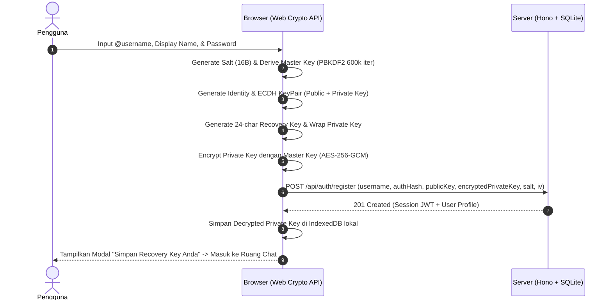
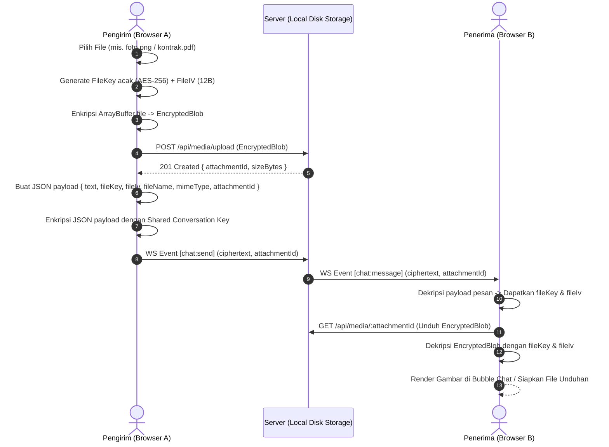

# Minimum Viable Product (MVP) Specification
**Nama Proyek:** WhisperWeb — Private E2EE Web Messenger  
**Target Rilis:** v1.0.0 (MVP)  
**Prinsip MVP:** *Fokus pada pengalaman chat inti ala WhatsApp Web yang cepat, stabil, dan 100% terenkripsi E2EE dari ujung ke ujung.*

---

## 1. Batasan Cakupan MVP (In-Scope vs Out-of-Scope)

Untuk memastikan rilis pertama dapat selesai tepat waktu dengan kualitas produksi yang tinggi, berikut adalah batasan tegas cakupan fitur MVP:

| Modul | ✅ In-Scope (Wajib Ada di MVP v1.0) | ❌ Out-of-Scope (Ditunda ke v1.1+) |
| :--- | :--- | :--- |
| **Autentikasi & Akun** | • Daftar & Login via `@username` + Password • Pembangkitan kunci E2EE otomatis di browser • Zero-Knowledge Encrypted Key Backup di server • Recovery Key (kode pemulihan akun) • Dukungan Passkey (WebAuthn) • Edit nama tampilan, bio/about, & foto profil | • Login via Nomor HP / SMS OTP • Login via Email / OAuth Google • Multi-akun dalam satu tab browser |
| **Kontak & Privasi** | • Cari pengguna dengan `@username` • Tampilan *Safety Number* (Fingerprint 60 digit) untuk verifikasi E2EE • Blokir / Buka blokir pengguna | • Sinkronisasi buku telepon HP • Pembacaan QR Code via kamera langsung |
| **Chat 1-on-1** | • Kirim/terima teks & emoji secara *real-time* • Kutip balasan (*Reply to message*) • Emoji Reaction pada pesan (6 emoji utama + pemilih) • Hapus pesan (*Delete for everyone* & *Delete for me*) • Pencarian teks di dalam ruang obrolan aktif | • Edit pesan yang sudah terkirim • *Forward* pesan berantai • *Pin* pesan di atas chat • Lokasi *live* / berbagi kontak |
| **Grup Kecil** | • Buat grup baru (maks. 50 anggota) • Distribusi & rotasi *Group Encryption Key* otomatis • Tambah/keluarkan anggota & pengaturan Admin • Ubah nama, deskripsi, dan ikon grup | • Grup besar (>50 anggota) / Channel siaran • Tautan undangan grup publik (*Invite Link*) • Polling / pemungutan suara di grup |
| **Media & File** | • Kirim gambar (`JPG`, `PNG`, `WEBP`, `GIF`) terenkripsi E2EE dengan pratinjau langsung & *Lightbox* • Kirim file/dokumen (`PDF`, `ZIP`, `DOCX`, `TXT`, dll. maks. 25 MB) terenkripsi E2EE • Indikator progres unggah/unduh & dekripsi | • Rekam pesan suara (*Voice Note*) • Editor/potong gambar di dalam browser • Kompresi video & pemutar video *streaming* |
| **Status & Kehadiran** | • Indikator Centang 1 (Terkirim), Centang 2 (Diterima), Centang 2 Emerald (Dibaca) • Indikator *Typing...* secara *real-time* • Status *Online* & *Last Seen* | • WhatsApp Status / Stories 24 jam • Panggilan Suara & Video (WebRTC) |

---

## 2. Alur Pengguna Inti (Core User Flows)

### 2.1 Alur 1: Registrasi & Pembangkitan Kunci E2EE (Onboarding)

### 2.2 Alur 2: Login di Perangkat / Browser Baru (Zero-Knowledge Restore)
1. Pengguna memasukkan `@username` dan `password` (atau memilih **Login dengan Passkey**).
2. Server memverifikasi kredensial autentikasi dan mengembalikan *Encrypted Key Vault* (`encrypted_private_key`, `key_salt`, `key_iv`) milik pengguna.
3. Browser menurunkan kembali *Master Key* dari `password` + `key_salt` menggunakan `PBKDF2`, lalu mendekripsi `encrypted_private_key` di memori browser.
4. Kunci privat yang berhasil dibuka disimpan ke dalam penyimpanan lokal browser (`IndexedDB`) dan digunakan untuk mendekripsi seluruh riwayat percakapan yang diunduh dari server.

### 2.3 Alur 3: Percakapan 1-on-1 & Pertukaran Kunci (ECDH)
1. Pengguna A mencari `@username` Pengguna B dan membuka ruang obrolan.
2. Browser Pengguna A mengambil `public_key` Pengguna B dari server.
3. Menggunakan algoritma **ECDH**, browser Pengguna A menggabungkan `private_key` miliknya dengan `public_key` Pengguna B (melalui `HKDF-SHA256`) untuk menghasilkan **Shared Conversation Key (`AES-256-GCM`)** yang identik di kedua sisi tanpa pernah dikirim melewati jaringan.
4. Setiap pesan dienkripsi dengan `AES-256-GCM` menggunakan `IV` acak 12-byte baru dan dikirim melalui WebSocket ke server.
5. Server menyimpan *ciphertext* ke SQLite, mengirim konfirmasi **Centang 1 (✓)** ke Pengguna A, dan meneruskan paket ke WebSocket Pengguna B.
6. Browser Pengguna B menerima paket, mendekripsi pesan, mengirim sinyal `delivered` (**Centang 2 ✓✓**), dan ketika ruang obrolan sedang dibuka oleh Pengguna B, mengirim sinyal `read` (**Centang 2 Emerald ✓✓**).

### 2.4 Alur 4: Pengiriman Gambar & File Terenkripsi (E2EE Media)

---

## 3. Tahapan Pengerjaan MVP (5 Milestones)

Pengembangan MVP dibagi ke dalam 5 tahapan berurutan yang jelas:

### Milestone 1: Fondasi Monorepo, Database SQLite, & Autentikasi API
- Inisialisasi *workspace* monorepo (`apps/web`, `apps/server`, `packages/shared`).
- Konfigurasi **Drizzle ORM** dengan **SQLite (WAL Mode)** di `apps/server`.
- Implementasi skema tabel (`users`, `passkey_credentials`, `conversations`, `conversation_members`, `messages`, `message_reactions`, `message_receipts`, `attachments`).
- Pembuatan endpoint REST autentikasi (`register`, `login`, `me`, `logout`, `recovery`, dan `passkey`) serta pencarian pengguna (`GET /api/users/search`).

### Milestone 2: Engine Kriptografi (Web Crypto) & Alur Onboarding UI
- Implementasi modul `crypto` di `apps/web` (Key Derivation `PBKDF2`, `ECDH` Key Pair generation, `HKDF`, `AES-256-GCM` encrypt/decrypt teks dan biner, serta pembungkus Recovery Key).
- Penyimpanan kunci lokal yang aman di `IndexedDB` dan sinkronisasi dengan Zustand store.
- Pembuatan halaman **Register**, **Login**, **Modal Simpan Recovery Key**, dan **Pemulihan Akun** dengan desain bertema WhatsApp Modern.

### Milestone 3: Engine Real-Time WebSocket & Chat 1-on-1 Inti
- Implementasi server WebSocket di `apps/server` untuk menangani autentikasi koneksi, *presence* (*Online/Last Seen*), status mengetik (*Typing*), pengantaran pesan, dan pembaruan *Read Receipts*.
- Pembuatan antarmuka utama 2-panel ala WhatsApp Web:
  - Sidebar kiri: Header profil, kolom pencarian chat/`@username`, daftar percakapan aktif dengan badge pesan belum dibaca (*unread count*) dan pratinjau pesan terakhir yang telah didekripsi.
  - Panel kanan: Header kontak + status *Online/Typing*, daftar *bubble* pesan dengan *auto-scroll*, fitur *Reply*, *Emoji Reaction*, *Delete Message*, dan indikator Centang 1/2/Emerald.
  - Drawer info kontak & modal verifikasi *Safety Number* 60-digit.

### Milestone 4: Grup Kecil Terenkripsi & Berbagi Media/Dokumen
- Implementasi pembuatan grup kecil, pembangkitan `GroupKey`, enkripsi `GroupKey` untuk setiap anggota grup, serta mekanisme rotasi kunci saat anggota dikeluarkan.
- Implementasi endpoint unggah dan unduh *encrypted binary blob* (`POST /api/media/upload` & `GET /api/media/:id`) yang menyimpan file di `./data/uploads`.
- Pembuatan UI pratinjau lampiran sebelum dikirim, *bubble* gambar dengan *skeleton loading* & *Lightbox*, serta kartu dokumen untuk file non-gambar.

### Milestone 5: Penyempurnaan UI/UX, Tema Dark/Light, Responsivitas & Verifikasi Akhir
- Implementasi pergantian tema **Dark Mode (Default)** dan **Light Mode** sesuai spesifikasi token di `DESIGN.md`.
- Penyempurnaan tampilan responsif di layar HP (*mobile single-pane navigation*) dan konfigurasi `manifest.json` untuk PWA.
- Pengujian *end-to-end* untuk memastikan seluruh kriteria penerimaan (*Acceptance Criteria*) terpenuhi tanpa kebocoran *plaintext* ke server.

---

## 4. Kriteria Penerimaan MVP (Definition of Done)

Sebuah rilis dinyatakan lulus sebagai **MVP v1.0** apabila seluruh poin berikut terpenuhi:
1. [ ] Pengguna dapat mendaftar hanya dengan `@username` + Password tanpa error, menerima Recovery Key, dan kunci privatnya tersimpan terenkripsi di database.
2. [ ] Dua pengguna di dua jendela browser berbeda dapat saling mencari `@username`, memulai chat 1-on-1, dan bertukar pesan teks secara *real-time* (`< 100ms`).
3. [ ] Indikator **Typing...**, **Online/Last Seen**, serta **Centang 1 $\rightarrow$ Centang 2 $\rightarrow$ Centang 2 Emerald** berubah secara *real-time* sesuai kondisi penerima.
4. [ ] Fitur **Reply (Kutip Pesan)**, **Emoji Reaction**, dan **Hapus Pesan** bekerja secara sinkron di kedua sisi.
5. [ ] Pengguna dapat membuat **Grup Kecil** (3+ akun), mengirim pesan grup terenkripsi, dan mengelola anggota.
6. [ ] Pengguna dapat mengirim **Gambar** (tampil langsung di *bubble* chat setelah didekripsi) dan **Dokumen/File** (dapat diunduh dan dibuka kembali dengan utuh).
7. [ ] Saat file database SQLite (`./data/chat.db`) dan direktori `./data/uploads/` diperiksa secara langsung, **tidak ada satu pun isi pesan teks maupun file gambar/dokumen yang dapat dibaca tanpa kunci dekripsi klien**.

